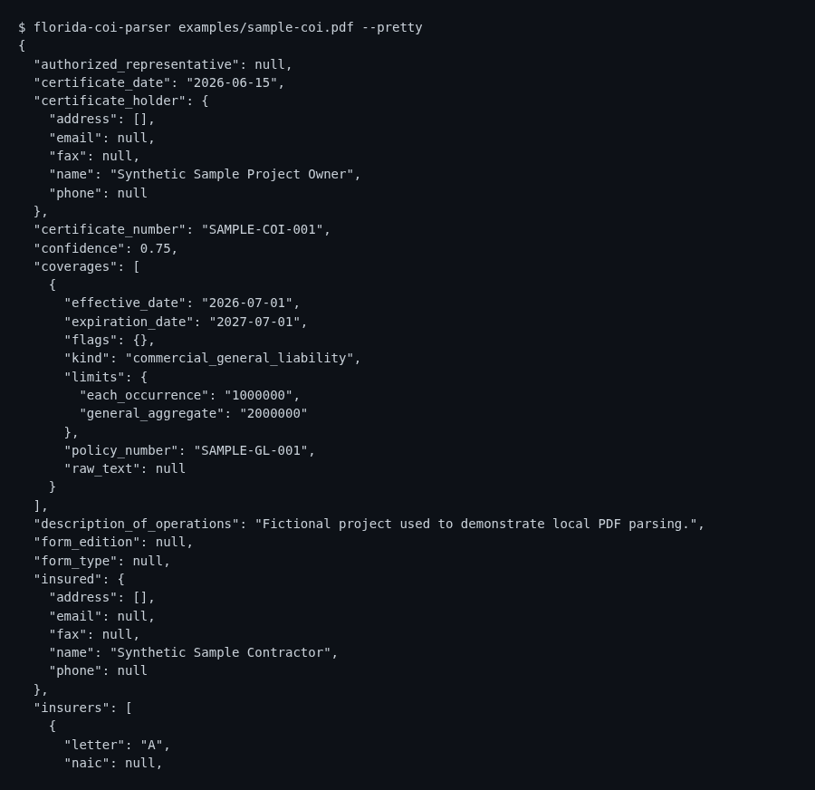

# florida-coi-parser

Local Python CLI for best-effort field extraction from ACORD 25 certificate PDFs

Every insurance agency and construction company in Florida handles these certificates. This open-source tool reduces manual transcription while keeping documents local and private.

## Installation

Clone the repository and install from the checkout with Python 3.9 or later.

```bash
git clone https://github.com/SourcyLab/florida-coi-parser.git
cd florida-coi-parser
pip install -e .
```

PyPI status is **not yet published**.

To enable optional local OCR for scanned certificates, install the `ocr` extra and ensure [Tesseract](https://github.com/tesseract-ocr/tesseract) is installed on your system.

```bash
pip install -e ".[ocr]"
```

## Quickstart

From the repository root, parse the [synthetic sample PDF](examples/sample-coi.pdf).

```bash
florida-coi-parser examples/sample-coi.pdf --pretty
```

The command prints JSON to stdout, with extraction warnings in the `warnings` array. The original sample is labeled “SYNTHETIC SAMPLE - not an ACORD form,” so the form identifier warning is expected. See the [full expected JSON](examples/sample-output.json) or the excerpt below.

```json
{
  "certificate_number": "SAMPLE-COI-001",
  "form_type": null,
  "warnings": [
    "Extracted values are best-effort text transcription, not a determination of coverage, endorsements, authenticity, cancellation, or compliance.",
    "The expected ACORD 25 identifier was not found; review the document type."
  ]
}
```



Regenerate the PDF with `python examples/make_sample.py`.

## Important Disclaimers

1. **Not Legal or Insurance Advice:** This is a data-extraction utility. It does not determine coverage, endorsements, certificate authenticity, cancellation status, or regulatory compliance. You must evaluate coverage against actual policies and endorsements using qualified professionals.
2. **ACORD Licensing:** ACORD states that users must be licensed by ACORD to use ACORD Forms. This library parses documents you supply; it does not generate, distribute, or bundle ACORD forms. You are responsible for securing the necessary permissions for the documents you process.
3. **Local First:** This library operates entirely locally. It makes no network requests, includes no telemetry, and does not persist your documents.

## Command-Line Usage

Extract a certificate to formatted JSON:

```bash
florida-coi-parser certificate.pdf --pretty
```

Save the output to a file and enable OCR if the text layer is missing:

```bash
florida-coi-parser scanned_certificate.pdf --ocr --output result.json
```

By default, the raw document text is excluded to prevent accidental leakage of sensitive business information. To include it in the JSON output, use `--include-raw-text`.

## Python API

The Python API provides typed dataclasses and deterministic JSON serialization.

```python
from florida_coi_parser import parse_acord25, ParseOptions

# Parse a local file
result = parse_acord25(
    "certificate.pdf",
    options=ParseOptions(include_raw_text=False, enable_ocr=False)
)

# Access typed fields
print(f"Insured: {result.insured.name}")
for coverage in result.coverages:
    print(f"{coverage.kind}: {coverage.policy_number}")
    if "each_occurrence" in coverage.limits:
        print(f"  Occurrence limit: ${coverage.limits['each_occurrence']}")

# Check for extraction warnings (e.g., missing fields)
for warning in result.warnings:
    print(f"Warning: {warning}")

# Export to a JSON-compatible dictionary
data = result.to_dict()
```

If you already hold the document in memory, use `parse_acord25_bytes(data)`.

## Extraction Behavior

The parser uses a conservative, anchor-driven strategy:

* It identifies standard ACORD 25 headings and coverage rows (General Liability, Auto, Umbrella/Excess, Workers' Comp).
* It normalizes unambiguous dates to `YYYY-MM-DD` and limits to plain decimal strings (e.g., `"1000000"`).
* It ignores empty template fields rather than misidentifying labels as policy numbers.
* It calculates a `confidence` score (0.0 to 1.0) based on the presence of recognized sections, not the legal validity of the certificate.

## Development

From the checkout, install the development dependencies.

```bash
pip install -e ".[dev]"
```

Run the tests and lint checks:

```bash
python -m pytest
ruff check src tests
```

The test suite uses only synthetic text and PDF fixtures. **Do not commit real certificates or proprietary form templates to this repository.**

## Built by Sourcy

Sourcy builds automation tools for insurance and construction teams. [Explore the Sitework document workflow demo](https://sourcyinc.com/demo/sitework?utm_source=github&utm_medium=referral&utm_campaign=oss_launch&utm_content=florida-coi-parser).

## License

MIT License. See `LICENSE` for details.
